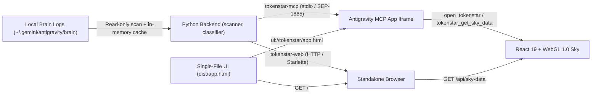

<div align="center">


# TokenStar

**Interactive WebGL 1.0 Starry-Sky Observatory & Token Analytics for Antigravity**

[](plugin/plugin.json)
[](backend/pyproject.toml)
[](frontend/package.json)
[](LICENSE)

**English** | [简体中文](README_zh.md)

</div>

---

**TokenStar** transforms your local Antigravity & Gemini conversation logs into a living, interactive planetarium sky. Every model request becomes an optically rendered star grouped with sibling requests from the same conversation into non-overlapping astronomical constellations, while an integrated analytics view tracks model token breakdown, daily heatmaps, and per-conversation telemetry.

It runs natively as an **Antigravity MCP App plugin** (`tokenstar-mcp`) directly inside Antigravity's conversation, side pane, or full-page sidebar view, as well as in **Standalone Web Mode** (`tokenstar-web`) in any desktop browser.

## Highlights

- **Real-Time WebGL 1.0 Optical Sky:** Six coordinated GPU shader programs render a tilted galactic panorama, parallax starfield catalog, world-space FBM emission/reflection nebulae, animated optical star PSFs with Hubble/JWST diffraction spikes, foreground cosmic dust motes, and smooth starlight sweeps along constellation bonds.
- **1 Request = 1 Star Constellations:** Conversations are laid out as distinct filament arcs, OB associations, and core-halo open clusters connected by Prim's Minimum Spanning Tree (`starLayout.ts` / `constellations.ts`), packed cleanly in 2D without inter-conversation overlap.
- **5 Celestial Archetypes:** Deterministically classifies both individual model requests and full conversations into main-sequence stars, binary star pairs, oblique-rotator pulsars, lensed black holes, and solar-wind comets.
- **Real Stellar Astrophysics Visuals:** Maps request token volume to relative + logarithmic magnitude/size scaling, and assigns Morgan-Keenan **O-B-A-F-G-K-M** blackbody colors (~30,000K sapphire blue to ~3,100K crimson) anchored by model family with natural H-R temperature dispersion.
- **Interactive Observatory Controls:** Pan, inertial glide, cursor-centered zoom, timeline epoch playback, multi-facet filtering (model, date, celestial type, search), equatorial RA/Dec grid / constellation / nebula HUD toggles, privacy mode, and 2x PNG wallpaper / commemorative card export.
- **Dual-Mode Architecture:** Communicates via SEP-1865 MCP App JSON-RPC (`@modelcontextprotocol/ext-apps`) inside Antigravity iframes and automatically falls back to local HTTP endpoints (`/api/sky-data`, `/api/refresh`) when opened standalone.

## Astronomical Encoding

### Celestial Classification (Strict Priority)

| Celestial Type | Visual Form in WebGL | Request Rule | Conversation Rule |
| :--- | :--- | :--- | :--- |
| **Black Hole** | Tilted Interstellar-style gravitational lensing disk + photon ring | Status in `ERROR`, `FAILED`, `CANCELLED`, or `ABORTED` | Terminal error status or error steps `>= 30%` |
| **Binary Star** | Keplerian orbiting pair with complementary hues + Roche plasma bridge | Calls `>= 1` subagent (`invoke_subagent` / `swarm`) | Calls `>= 1` subagent across tree |
| **Pulsar** | Oblique rotator with steady spin-axis torus & precessing Doppler jets | High-frequency tools (`tool_calls >= 8`) | Cumulative tools `>= 40` |
| **Comet** | Elliptical coma + dusty fan tail & plasma disconnection wave knots | Lightweight turn (`tool_calls == 0` & `< 15K` tokens) | `<= 2` turns, `<= 2` tools, and `< 50K` tokens |
| **Main-Sequence Star** | Optical Moffat PSF core + corona, halo, and bright-giant diffraction spikes | All remaining reasoning requests | All remaining deep conversations |

### Brightness & Color Mapping

- **Brightness & Core Radius (Token Usage):** Combines dataset-wide `p05`–`p98` relative log-token quantiles (`0.82` weight) with absolute `(log10(tokens) - 3.0) / 3.0` magnitude (`0.18` weight), mapping requests across `[0.12, 1.0]` magnitude and nonlinear `0.9–5.4 px` PSF core radii with intensity-scaled coronae, diffraction spikes, and lens streaks.
- **Spectral Color (Model + H-R Blackbody Temperature):** Anchors each model family along the **O-B-A-F-G-K-M** blackbody curve (`#68a4ff` → `#94c4ff` → `#dcebff` → `#fff5de` → `#ffdc84` → `#ffa654` → `#ff6e46`) while introducing deterministic per-star H-R temperature variation for realistic cosmic color diversity.

## Architecture



## Privacy & Local Read-Only Guarantees

- **Strictly Read-Only Log Scanning:** Reads `~/.gemini/antigravity/brain` (overridable via `TOKENSTAR_BRAIN_DIR` or `--brain-dir`) and `~/.gemini/tmp` without creating, modifying, or deleting any conversation or Antigravity state files.
- **No Host Config Mutation:** Installation only writes inside the isolated target plugin directory (`~/.gemini/config/plugins/tokenstar`) and never edits `~/.gemini/config/config.json` or Antigravity binaries.
- **100% Offline Single-File UI:** `dist/app.html` bundles React, `@modelcontextprotocol/ext-apps`, WebGL shaders, and styles into a single self-contained HTML file (`< 10 MiB`, ~831 KiB) with zero external CDN or network requests.
- **Ephemeral In-Memory Cache:** File fingerprints and computed star rollups stay strictly in server memory during execution.

## Prerequisites

- **Python 3.12–3.13** with [`uv`](https://docs.astral.sh/uv/)
- **Node.js (>= 20) & npm** (automatically picked up from `.tools/nodejs` if present)
- **Antigravity** (for MCP App plugin mode; Standalone Web Mode runs without Antigravity)

## Quick Start

### 1. Build the Single-File Bundle

```powershell
powershell -ExecutionPolicy Bypass -File scripts/build.ps1
```

On macOS / Linux shells:

```bash
npm --prefix frontend install && npm --prefix frontend run build
uv --project backend sync --no-dev
```

### 2. Option A — Install as an Antigravity MCP App Plugin

Package and install into `~/.gemini/config/plugins/tokenstar` (automatically syncs an isolated runtime `.venv` via `uv sync --no-dev`):

```powershell
powershell -ExecutionPolicy Bypass -File scripts/install-plugin.ps1
```

Optional installer flags:

| Flag | Description |
| :--- | :--- |
| `-TargetDir <path>` | Override installation directory (default: `$HOME\.gemini\config\plugins\tokenstar`) |
| `-SkipBuild` | Stage using an existing `dist/app.html` without re-running `scripts/build.ps1` |
| `-SkipSync` | Skip `uv --project <TargetDir>\server sync --no-dev` (for offline CI staging) |

Once staged, Antigravity automatically discovers the plugin:

- Click **TokenStar** in the Antigravity left sidebar for the full-page observatory (`global` entrypoint).
- Open **TokenStar** from the right side pane `+` menu (`aux_pane` entrypoint).
- Or ask the agent in chat to open TokenStar (`open_tokenstar`).

#### Uninstall Plugin

Remove the isolated directory directly (no global config changes to revert):

```powershell
Remove-Item -Recurse -Force "$HOME\.gemini\config\plugins\tokenstar"
```

### 3. Option B — Standalone Web Mode

Launch the local Starlette observatory server and open it in your browser:

```powershell
uv --project backend run tokenstar-web --open
```

Available CLI options for `tokenstar-web`:

| Option | Default | Description |
| :--- | :--- | :--- |
| `--brain-dir <path>` | `~/.gemini/antigravity/brain` | Override read-only log root (or env `TOKENSTAR_BRAIN_DIR`) |
| `--host <addr>` | `127.0.0.1` | Bind host address |
| `--port <num>` | `18420` | Starting port (scans up to 20 consecutive ports if busy) |
| `--html-path <path>` | `dist/app.html` | Override compiled UI HTML path (or env `TOKENSTAR_APP_HTML`) |
| `--open` | `false` | Open the observatory URL automatically in the default browser |

## Development & Verification

Run all checks (TypeScript `tsc --noEmit`, Vitest suite, Vite single-file build & external-URL audit, and backend Pytest suite):

```powershell
powershell -ExecutionPolicy Bypass -File scripts/build.ps1
```

Or run frontend / backend suites individually:

```powershell
npm --prefix frontend run typecheck
npm --prefix frontend run test
uv --project backend run pytest backend/tests -v
```

## Project Structure

```text
tokenstar-plugin/
├── backend/
│   ├── src/tokenstar/
│   │   ├── sources/        # Read-only Antigravity & Gemini CLI transcript adapters
│   │   ├── classifier.py   # Priority-ordered celestial classifier
│   │   ├── config.py       # Classification thresholds & path defaults
│   │   ├── scanner.py      # Subagent tree rollup & incremental cache
│   │   ├── mcp_server.py   # SEP-1865 MCP App stdio server (tokenstar-mcp)
│   │   └── web_server.py   # Standalone HTTP server (tokenstar-web)
│   └── tests/              # Pytest unit & server integration tests
├── frontend/
│   ├── src/
│   │   ├── components/
│   │   │   ├── sky/        # WebGL 1.0 sky renderer, overlay canvas, HUD, drawer
│   │   │   └── stats/      # Heatmap, token breakdown & sortable session tables
│   │   ├── logic/          # Layout physics, MST constellations, metrics & filters
│   │   └── services/       # Dual-mode MCP App + HTTP transport
│   └── package.json
├── plugin/
│   ├── assets/logo.svg     # Plugin card & navigation emblem
│   ├── mcp_config.json     # ${PLUGIN_ROOT} MCP server manifest
│   └── plugin.json         # Antigravity plugin metadata & suggested prompts
├── scripts/
│   ├── build.ps1           # Full verification & single-file HTML build script
│   └── install-plugin.ps1  # Isolated plugin bundler & uv runtime sync
├── LICENSE                 # MIT License
├── README.md               # English documentation
└── README_zh.md            # 简体中文文档
```

## License

Licensed under the [MIT License](LICENSE).
