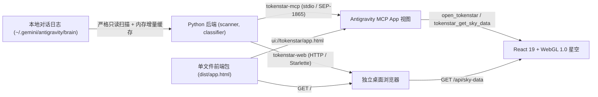

<div align="center">


# TokenStar

**面向 Antigravity 的 WebGL 1.0 实时星空可视化与 Token 统计分析插件**

[](https://github.com/ivvan3016/gemini-tokenstar-plugin/releases/latest)
[](https://github.com/ivvan3016/gemini-tokenstar-plugin/stargazers)
[](plugin/plugin.json)
[](backend/pyproject.toml)
[](frontend/package.json)
[](LICENSE)

[English](README.md) | **简体中文**

</div>

---

**TokenStar** 将本地 Antigravity 与 Gemini 对话日志映射为一片可实时交互的写实星空。每一次模型请求对应一颗独立恒星，同一段对话内的主代理与子代理步骤通过无交叉连线织成互不重叠的天文星座；同时内置多维统计仪表盘，呈现每日 Token 热力图、模型分布及明细检索。

插件支持两种运行形态：**Antigravity MCP App 插件模式**（`tokenstar-mcp`，直接嵌入侧栏、辅助栏或对话内）与 **独立 Web 服务模式**（`tokenstar-web`，在桌面浏览器中运行）。

<!-- Showcase: 开启隐私模式录制 demo.gif 与导出的 2x 纪念卡 sky-card.png 放入 docs/media/ 后取消注释即可展示
<div align="center">
  
  <br />
  
</div>
-->

## 核心特性

- **把 Token 消耗变成一片实时星空**：每一次模型请求化作一颗 WebGL 光学恒星，每段对话织成互不重叠的专属星座，汇成属于你的深空银河。
- **五类天体与子代理伴星团**：根据对话与协作特征自然演化为恒星、双星与可展开的子代理伴星团、脉冲星、黑洞和彗星，让 AI 协作形态一目了然。
- **真实星等亮度与恒星光谱**：Token 消耗越高星体越耀眼，不同模型家族呈现从蓝巨星到红巨星的自然恒星色温。
- **自由漫游、统计分析与一键晒图**：支持丝滑缩放探索、时间轴演化回放、每日用量热力图与明细统计，并可导出 2x 高清星空壁纸或纪念卡片。
- **纯本地只读，开箱即用**：100% 本地离线解析、绝不修改对话日志；原生集成于 Antigravity（支持插件内检查更新），也可独立浏览器运行。

## 天文映射规则

### 天体分类体系（按严格优先级判定）

| 天体类型 | WebGL 实时视觉特征 | 单次请求判定条件 | 整段会话判定条件 |
| :--- | :--- | :--- | :--- |
| **黑洞** | 星际穿越风格引力透镜吸积盘、光子环与事件视界遮罩 | 状态为 `ERROR` / `FAILED` / `CANCELLED` / `ABORTED` | 异常终止状态或错误步骤占比 `>= 30%` |
| **双星** | 开普勒双星轨道运转、冷暖光谱互补及洛希瓣物质流 | 调用子代理 `>= 1` 次（`invoke_subagent` / `swarm`） | 会话内调用 `>= 1` 次子代理协同 |
| **脉冲星** | 固定自旋赤道风环、微倾斜转子进动双极射流与多普勒脉冲 | 单步并行工具调用 `>= 8` 次 | 会话累计工具调用 `>= 40` 次 |
| **彗星** | 椭圆彗发、曲面尘埃扇尾与太阳风离子波结 | 工具调用为 `0` 且总 Token `< 15K` | 交互 `<= 2` 轮、工具 `<= 2` 次且 `< 50K` |
| **恒星** | 光学 Moffat 星核、星冕光晕与高亮巨星衍射星芒 | 其余常规深度推理请求 | 其余常规深度多轮对话 |

### 亮度、尺寸与光谱色

- **Token 用量 → 星等与星核尺度**：融合当前全部请求对数用量的 `p05`–`p98` 相对分位（权重 `0.82`）与绝对对数标度 `(log10(tokens) - 3.0) / 3.0`（权重 `0.18`），映射至 `[0.12, 1.0]` 星等与非线性 `0.9–5.4 px` 星核半径，联动星冕亮度、衍射星芒与镜头炫光分级呈现。
- **模型家族 + 真实黑体光谱色**：以 **O-B-A-F-G-K-M** 7 阶黑体色谱（`#68a4ff` → `#94c4ff` → `#dcebff` → `#fff5de` → `#ffdc84` → `#ffa654` → `#ff6e46`）为模型分配主导色温带，并叠加确定的单星赫罗图（H-R）色温色散，仅对极亮星核中心保留白炽高光，避免高亮全白化。

## 系统架构



## 隐私与本地只读保障

- **严格只读扫描**：仅以只读方式解析 `~/.gemini/antigravity/brain`（可通过 `TOKENSTAR_BRAIN_DIR` 或 `--brain-dir` 覆盖）与 `~/.gemini/tmp`，绝不写入、修改或删除任何对话日志与宿主文件。
- **零侵入安装**：安装脚本仅将文件部署至独立插件目录 `~/.gemini/config/plugins/tokenstar`，绝不改写 `~/.gemini/config/config.json` 或任何 Antigravity 核心文件。
- **100% 离线自包含界面与按需检查更新**：构建产物 `dist/app.html` 将全部 JS、CSS 与着色器内联于单个 HTML 文件中（约 883 KiB，`< 10 MiB` 上限），日常运行不含任何外部 CDN 或遥测请求；仅在用户主动点击顶栏“检查更新”时请求 GitHub Releases 接口。
- **纯内存增量索引**：文件指纹与汇总索引仅在服务端进程内存中缓存。

## 环境要求

- **安装预构建 Release 包（推荐）：** 仅需 [`uv`](https://docs.astral.sh/uv/)（会自动管理 Python 3.12–3.13 运行时，**无需安装 Node.js**）。
- **从源码构建 / 本地开发：** [`uv`](https://docs.astral.sh/uv/) + **Node.js (>= 20) 与 npm**（存在 `.tools/nodejs` 时构建脚本会自动优先使用）+ **Git**。
- **Antigravity：** 仅插件模式需要（`uv` 需位于 Antigravity 可见的系统 `PATH` 中）；独立 Web 模式无需启动 Antigravity。

## 快速开始

### 方式 A：通过预构建 Release 包快速安装（推荐，无需 Node.js）

直接从 [GitHub Releases](https://github.com/ivvan3016/gemini-tokenstar-plugin/releases/latest) 下载 `tokenstar-plugin.zip`，解压到 `~/.gemini/config/plugins/tokenstar` 并同步隔离环境即可：

#### Windows (PowerShell)

```powershell
$dest = Join-Path $HOME '.gemini\config\plugins\tokenstar'
$zip = Join-Path $env:TEMP 'tokenstar-plugin.zip'
Invoke-WebRequest 'https://github.com/ivvan3016/gemini-tokenstar-plugin/releases/latest/download/tokenstar-plugin.zip' -OutFile $zip
foreach ($p in 'plugin.json','mcp_config.json','assets','dist','server\pyproject.toml','server\uv.lock','server\src') { Remove-Item -Recurse -Force (Join-Path $dest $p) -ErrorAction SilentlyContinue }
New-Item -ItemType Directory -Path $dest -Force | Out-Null
Expand-Archive -Path $zip -DestinationPath $dest -Force
uv --project (Join-Path $dest 'server') sync --no-dev
```

#### macOS / Linux

```bash
DEST="$HOME/.gemini/config/plugins/tokenstar"
TMP_ZIP="$(mktemp -t tokenstar-plugin.XXXXXX.zip)"
curl -fL 'https://github.com/ivvan3016/gemini-tokenstar-plugin/releases/latest/download/tokenstar-plugin.zip' -o "$TMP_ZIP"
rm -rf "$DEST/plugin.json" "$DEST/mcp_config.json" "$DEST/assets" "$DEST/dist" "$DEST/server/pyproject.toml" "$DEST/server/uv.lock" "$DEST/server/src"
mkdir -p "$DEST" && unzip -o "$TMP_ZIP" -d "$DEST" && rm -f "$TMP_ZIP"
uv --project "$DEST/server" sync --no-dev
```

#### 交给 Antigravity Agent 一句话安装

把下面这段话直接发给你的 Antigravity Agent，即可跨平台自动完成安装：

> 请从 https://github.com/ivvan3016/gemini-tokenstar-plugin 安装 TokenStar 插件到 `~/.gemini/config/plugins/tokenstar`（优先下载最新 GitHub Release 的 `tokenstar-plugin.zip` 预构建包以跳过 Node.js；或 clone 仓库后执行 `scripts/install.py` / `scripts/install-plugin.ps1` / `scripts/install-plugin.sh`），随后运行 `uv --project ~/.gemini/config/plugins/tokenstar/server sync --no-dev`。安装过程不要修改 `~/.gemini/config/config.json`。

插件目录 `~/.gemini/config/plugins/tokenstar` 的完整结构如下：

```text
~/.gemini/config/plugins/tokenstar/
├── plugin.json
├── mcp_config.json
├── assets/
│   └── logo.svg
├── dist/
│   └── app.html
└── server/
    ├── pyproject.toml
    ├── uv.lock
    └── src/
```

### 方式 B：从源码构建安装（Windows / macOS / Linux）

克隆仓库后，按系统运行一条命令即可完成安装（首次运行会自动安装 `frontend/node_modules`、打包单文件 `dist/app.html`、复制插件文件至 `~/.gemini/config/plugins/tokenstar` 并同步 `uv` 环境）：

```bash
git clone https://github.com/ivvan3016/gemini-tokenstar-plugin.git
cd gemini-tokenstar-plugin
```

- **Windows (PowerShell)：**

  ```powershell
  powershell -ExecutionPolicy Bypass -File scripts/install-plugin.ps1
  ```

- **macOS / Linux：**

  ```bash
  bash scripts/install-plugin.sh
  ```

- **跨平台 Python（`scripts/install.py`）：**

  ```bash
  uv run --no-project python scripts/install.py
  ```

安装脚本常用参数：

| Windows (`install-plugin.ps1`) | macOS / Linux (`install-plugin.sh`) | 跨平台 (`install.py`) | 说明 |
| :--- | :--- | :--- | :--- |
| `-TargetDir <path>` | `--target-dir <path>` | `--target-dir <path>` | 自定义安装目录（默认：`~/.gemini/config/plugins/tokenstar`） |
| `-Verify` | `--verify` | `--verify` | 从源码构建时同时运行完整 TypeScript、Vitest 与 Pytest 测试 |
| `-SkipBuild` | `--skip-build` | `--skip-build` | 复用已有 `dist/app.html`，跳过前端构建 |
| `-SkipSync` | `--skip-sync` | `--skip-sync` | 跳过 `uv --project <TargetDir>/server sync --no-dev`（离线打包校验用） |
| — | — | `--from-release [TAG]` | 从 GitHub Releases 下载并安装预构建包（默认 `latest`） |
| — | — | `--from-zip <path>` | 从本地预构建 `tokenstar-plugin.zip` 压缩包安装 |
| — | — | `--pack <output.zip>` | 构建并生成可分发的插件 Release 压缩包 |

#### 在 Antigravity 中打开

安装完成后 Antigravity 会自动发现该插件，可通过以下任意方式打开：

- 在 Antigravity **左侧导航栏**点击 **TokenStar** 全屏查看；
- 在右侧辅助栏右上角 **`+`** 菜单中选择 **TokenStar** 侧边打开；
- 在对话中直接让助手调用 `open_tokenstar` 打开交互视图。

#### 插件内一键更新（`v0.1.2+`）

点击顶部栏更新图标即可检查 GitHub Releases 最新版本并原地完成升级：

- **仅前端改动**：重新打开 TokenStar 视图即可生效；
- **包含后端改动**：更新后按提示关闭并重新打开 Antigravity 即可加载新版本后端。

#### 卸载插件

直接删除插件隔离目录即可（无任何全局配置残留）：

```powershell
# Windows (PowerShell)
Remove-Item -Recurse -Force "$HOME\.gemini\config\plugins\tokenstar"
```

```bash
# macOS / Linux
rm -rf "$HOME/.gemini/config/plugins/tokenstar"
```

### 方式 C：独立 Web 模式运行

若仓库中尚未生成 `dist/app.html`，先构建一次前端单文件包，再启动本地 Starlette 服务：

```bash
npm --prefix frontend ci && npm --prefix frontend run build
uv --project backend run tokenstar-web --open
```

`tokenstar-web` 支持的命令行参数：

| 参数 | 默认值 | 说明 |
| :--- | :--- | :--- |
| `--brain-dir <path>` | `~/.gemini/antigravity/brain` | 指定只读对话日志目录（或设置 `TOKENSTAR_BRAIN_DIR`） |
| `--host <addr>` | `127.0.0.1` | 监听主机地址 |
| `--port <num>` | `18420` | 起始端口（若占用会自动向后顺延探测最多 20 个端口） |
| `--html-path <path>` | `dist/app.html` | 指定编译后的单文件 HTML 路径（或设置 `TOKENSTAR_APP_HTML`） |
| `--open` | `false` | 服务就绪后自动打开默认浏览器 |

## 开发与测试

在 Windows 上执行完整构建与前后端测试流水线（缺少 `frontend/node_modules` 时会自动安装依赖，随后依次运行 `tsc --noEmit`、Vitest 单测、单文件 `dist/app.html` 体积与零外链审计及后端 Pytest；传入 `-SkipTests` 可仅构建）：

```powershell
powershell -ExecutionPolicy Bypass -File scripts/build.ps1
```

跨平台分模块测试与构建命令：

```bash
npm --prefix frontend ci
npm --prefix frontend run typecheck
npm --prefix frontend run test
npm --prefix frontend run build
uv --project backend run pytest backend/tests -v
```

## 项目结构

```text
tokenstar-plugin/
├── backend/
│   ├── src/tokenstar/
│   │   ├── sources/        # Antigravity / Gemini CLI 只读日志适配器
│   │   ├── classifier.py   # 严格优先级天体分类器
│   │   ├── config.py       # 分类阈值与默认路径配置
│   │   ├── scanner.py      # 子代理树、父请求精准归因与内存增量扫描缓存
│   │   ├── updater.py      # GitHub Release 更新检查与安全原地升级
│   │   ├── mcp_server.py   # SEP-1865 MCP App 服务端 (tokenstar-mcp)
│   │   └── web_server.py   # 独立 Web HTTP 服务端 (tokenstar-web)
│   └── tests/              # Pytest 单元测试与服务集成测试
├── frontend/
│   ├── src/
│   │   ├── components/
│   │   │   ├── sky/        # WebGL 1.0 渲染器、2D 叠层、HUD 与详情抽屉
│   │   │   ├── stats/      # 每日热力图、模型分布与会话统计表
│   │   │   ├── TopBar.tsx  # 顶部导航栏、实时刷新与版本更新入口
│   │   │   └── UpdateModal.tsx # 插件内更新状态与一键升级弹窗
│   │   ├── logic/          # 星图布局算法、MST 连线与多维过滤统计
│   │   └── services/       # MCP App / HTTP 双模传输层
│   └── package.json
├── plugin/
│   ├── assets/logo.svg     # 插件图标资源
│   ├── mcp_config.json     # 使用 ${PLUGIN_ROOT} 的 MCP 服务定义
│   └── plugin.json         # Antigravity 插件元信息与推荐提示词
├── scripts/
│   ├── build.ps1           # 全量验证与单文件构建脚本
│   ├── install.py          # 跨平台源码安装与 Release 打包脚本
│   ├── install-plugin.ps1  # Windows 隔离插件打包与 uv 环境同步脚本
│   └── install-plugin.sh   # macOS / Linux 隔离插件打包与 uv 环境同步脚本
├── LICENSE                 # MIT 开源协议
├── README.md               # 英文主文档
└── README_zh.md            # 简体中文文档
```

## 开源协议

本项目基于 [MIT License](LICENSE) 开源。
